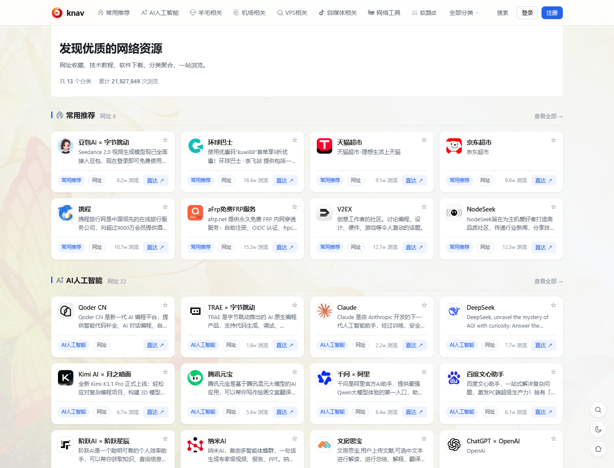
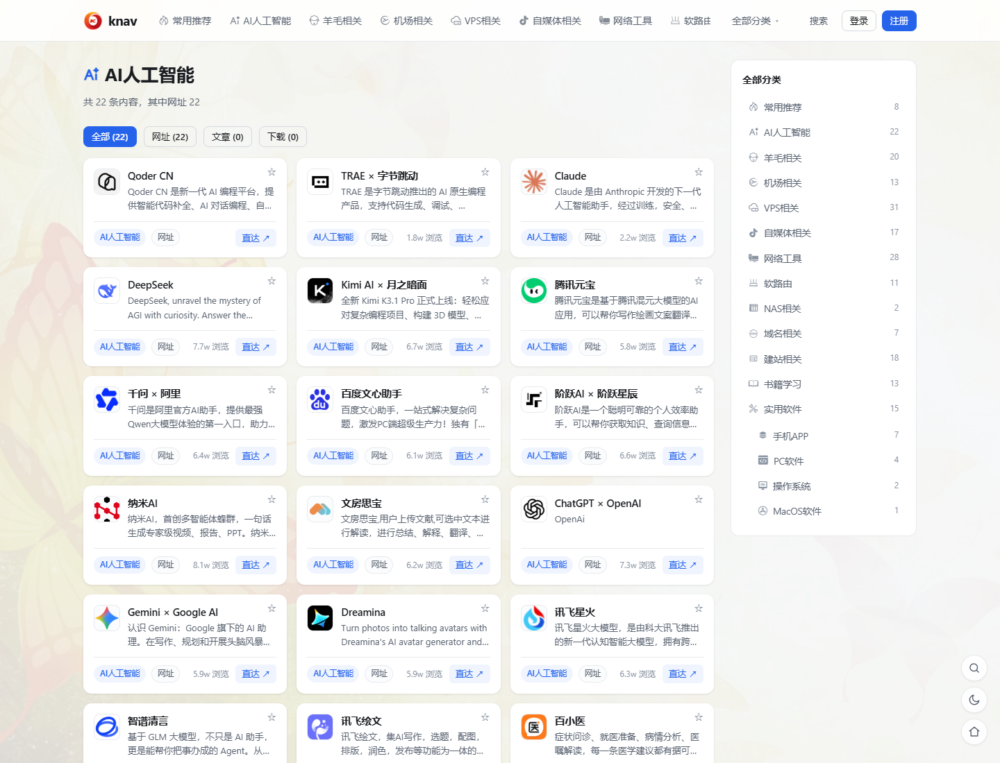
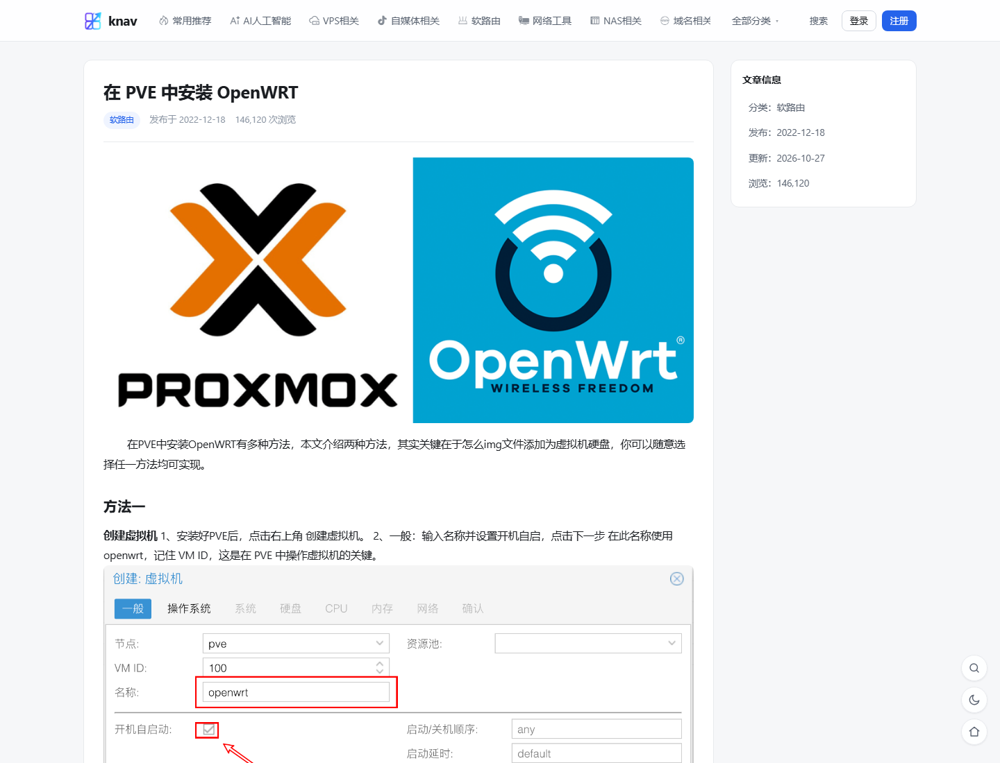
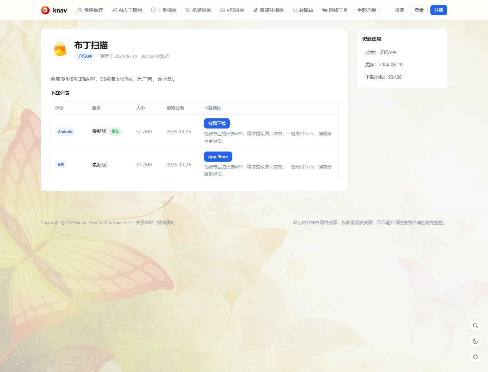
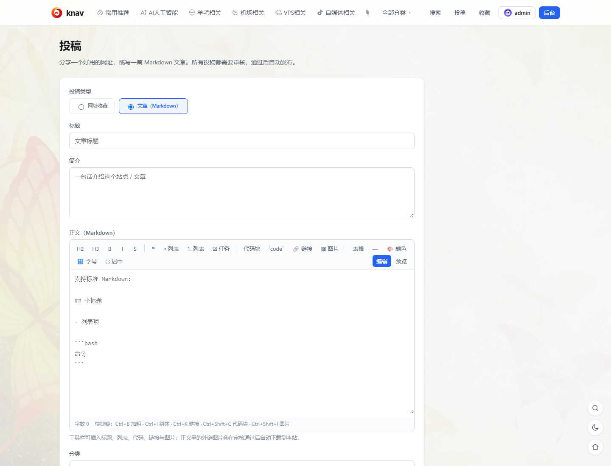
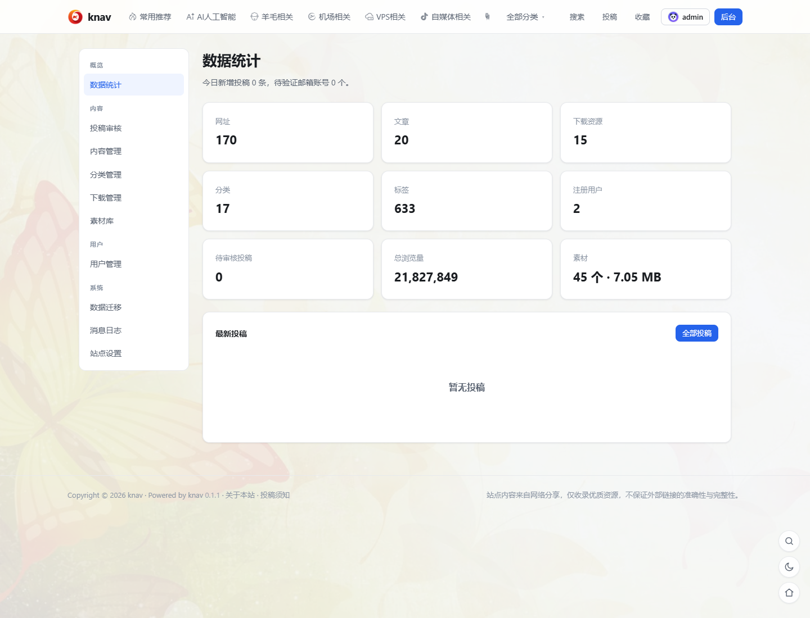
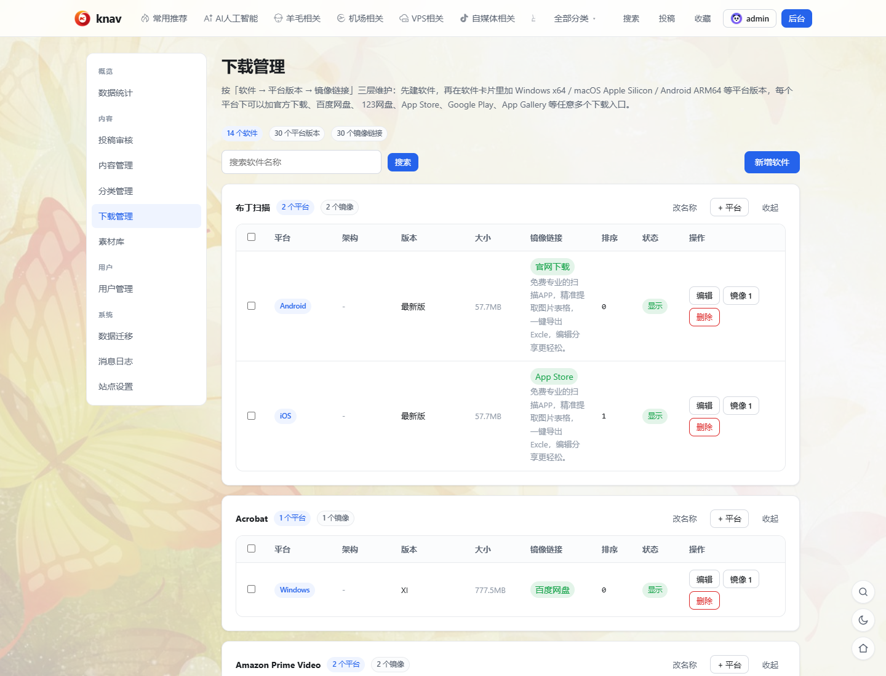

# knav

knav 是一个基于 Next.js 15 与 MySQL 8 的导航站 / 资源分享站点系统。网址收藏、技术文章与软件下载共用同一套分类轴和卡片样式，站内自带账号体系、投稿审核、下载管理、素材库与完整后台。

- **统一展示**：同一个分类下的网址与文章混排，卡片外观完全一致，只有操作按钮不同（网址 → `直达 ↗`，文章 → `阅读 →`）
- **软件下载**：按「软件 → 平台版本 → 镜像链接」三层维护，支持多平台、多架构与多个下载入口
- **完整账号体系**：邮箱注册验证、找回密码、站内通知、收藏，以及 Telegram / GitHub / Gitee / Google 第三方登录
- **独立数据表结构**：使用 `knav_*` 表存储数据；可从 knav、WordPress / OneNav、Typecho、Z-BlogPHP、Emlog、Halo 1.x 及常见导航站的数据库一次性导入存量内容
- **空仓库起步**：仓库只包含源码与默认静态资源（LOGO、内置头像），**不包含数据库数据与上传文件**；`public/uploads/` 为空且已排除，按「部署」一节初始化后是一个空站，只有创建的站长账号

---

## 演示截图

<p align="center">
  
  
</p>
<p align="center">
  
  
</p>
<p align="center">
  
  
</p>
<p align="center">
  
  
</p>

> 截图为本地演示数据，仅用于展示界面。

---

## 功能

### 浏览与搜索

- 首页、分类页、标签页、搜索页；网址、文章、软件在同一分类下混排
- **顶栏全站搜索面板**：站内搜索 / Bing / 百度 / Google / 360 / 搜狗，外部引擎在新标签页打开
  - 面板从顶栏整块展开，所有页面可用；再次点击、点「关闭」、点遮罩或按 `Esc` 收起
  - 热门搜索（百度实时热榜，取不到时退回站内浏览量榜，并标明来源）
  - 搜索历史只保存在浏览器 `localStorage`，不落库、不上报，可一键清空
- **全部分类下拉面板**：顶级分类铺开显示，二级分类默认收起并带数量角标，点箭头展开
- **文章详情**：Markdown 渲染 + HTML 白名单过滤；代码块支持复制按钮与多主题切换；
  正文图片限制最大分辨率并懒加载，不撑破容器
- **网址详情**：图标、简介、标签、浏览量、备用地址
- **软件详情**：按「平台 + 架构」逐条列出版本与全部镜像入口（官方下载 / 网盘 / 应用商店）
- 收藏、站内通知、站点地图 `/sitemap.xml` 与 `robots.txt`
- 响应式布局、深色模式、可配置站点壁纸

### 账号与登录

- 注册（必须邮箱验证）、登录、退出、忘记密码 / 重置密码
- 个人资料、修改邮箱、修改密码、站内通知中心、我的收藏
- **头像**：上传图片（≤2 MB）、从 12 张内置头像中选择、或使用标题首字母默认头像
  - 上传按文件头魔数判定真实格式（PNG / JPEG / GIF / WebP），拒收 SVG
  - 内置头像与默认头像排成一行横向滚动，窄屏左右滑动
- **多方式登录**：账号密码 / Telegram / GitHub OAuth2 / Gitee OAuth2 / Google OAuth2
  - 后台可分别开关并配置凭据；首次登录需选择「绑定已有账号」或「新建账号」，新建账号读取第三方资料作默认值并可修改，邮箱必须完成本站验证
  - 个人中心可查看、绑定、解绑各平台账号；后台用户管理可查看绑定并代为解绑
  - 后台「登录方式」直接列出可复制的回调地址：`<站点地址>/api/auth/<github|gitee|google>/callback`
  - 回调地址与实际登录提交的 `redirect_uri` 同源同算法，支持子目录部署

### 投稿与审核

- 投稿分两类：网址收藏（URL + 图标）与文章（Markdown 正文 + 实时预览）
- 网址投稿支持**「获取信息」**：自动抓取目标站点的名称、简介与图标并回填
  - 抓取前做 SSRF 校验（内网 / 保留地址 / 非 http(s) 直接拒绝），同一用户 3 秒内限抓一次
- 文章使用带工具栏的 Markdown 编辑器：标题 / 加粗斜体删除线 / 引用 / 三种列表 / 代码块 /
  链接图片 / 表格 / 分割线 / 颜色字号居中 / 编辑预览切换，支持常用快捷键
- 投稿只能归入已有分类；服务端同步校验分类是否存在
- 投稿进入待审队列，管理员通过后自动发布；驳回必须填写审核意见并通知作者
- 审核结果同时发送站内通知与邮件；标签自动匹配已有标签，不产生重复项

### 后台管理

- **数据统计**：网址 / 文章 / 下载资源 / 分类 / 标签 / 注册用户 / 待审核投稿 / 总浏览量，以及素材数量与占用空间
- **投稿审核队列**：通过、驳回、查看投稿全文
- **分类管理**：增删改、图标、排序、封面、主题色、父子层级
  - 二级分类缩进挂在所属顶级分类下并默认收起，上下移动只在同一上级内生效
  - 新建分类的别名（slug）默认按名称拼音首字母生成（「常用推荐」→ `cytj`），撞名自动加序号
- **内容管理**：新增 / 编辑 / 删除 / 置顶 / 排序 / 改分类 / 发布下架，支持批量操作
  - 按顶级分类筛选会连带列出其全部子分类的内容；排序只在该分类内部生效
  - 添加网址时点「获取信息」可自动抓取名称、简介、图标与封面
- **下载管理**：软件 → 平台版本 → 镜像链接三层维护
  - 平台版本带架构字段（x64 / x86 / ARM64 / Apple Silicon / universal / OpenWrt 等）
  - 每个平台可挂任意多个镜像；软件、平台与镜像都能单独启停、排序，平台支持批量启停与删除
- **素材库**：上传图片 / 附件、外链图片本地化、按来源或文件名搜索、复制站内地址、删除
- **用户管理**：新增 / 编辑 / 删除 / 封禁与解封 / 改角色 / 重置密码 / 单发通知
  - 列表显示该用户的通知数（含未读）与收藏数
  - 管理员改用户邮箱会清空验证状态、踢掉全部会话，并向新邮箱重新发送验证邮件
  - 重置密码可留空（只发 24 小时一次性设置链接）或填入新密码（立即生效并踢掉全部会话）
- **站长（owner）**：全站唯一，只能通过用户列表的「转移站长」变更；站长账号不可降级、封禁或删除
- **站点重置（仅站长）**：按数据类别多选清空（内容 / 分类与标签 / 投稿 / 下载 / 素材 / 用户 /
  通知与邮件日志 / 操作日志 / 站点设置），站长账号与当前会话始终保留；
  执行前需向站长邮箱发送 6 位验证码并二次确认
- **消息日志**：邮件日志与站内通知合到一页，两个页签切换
- **站点设置**：13 个分组按字段级保存，改完即时生效
  - 基础信息 / LOGO 与图标 / 外观与卡片 / 代码块 / SEO / 页脚与版权 / 广告栏 /
    公告与开关 / 站点壁纸 / 统计与代码 / 登录方式 / 邮件（SMTP）/ 邮件模版
  - 邮件模版覆盖验证邮箱、找回密码、管理员重置密码、投稿审核结果、站长重置验证码、管理员通知六个场景，
    支持 `{{site}}`、`{{username}}`、`{{url}}` 等占位符，并可在保存前预览
- **操作日志**：记录后台关键操作（操作人、动作、对象、时间）
- **表单位置**：内容、分类、下载、用户的编辑表单就地展开在被编辑那一行的正下方，新增表单在列表上方

### 外观

- 站点 LOGO 与 favicon 可在后台配置；默认使用 `public/logo.png` 与 `src/app/icon.png`
- **站点壁纸**：Bing 每日壁纸 / 小鸟壁纸 / 随机风景 / 自定义图片，可调遮罩浓度
  - 小鸟壁纸支持「每天一张」或「每次刷新换一张」，11 个分类可勾选
  - 按视口长边与像素比选择合适分辨率，小屏幕不加载超大图
- **卡片**：统一高度、列数、圆角、密度、标题行数、显示字段（分类 / 类型 / 浏览量 / 标签）均可配置
- 分类图标支持内置 SVG 图标库、图片地址、Emoji 与 iconfont 类名
- 代码块 6 套主题（GitHub / Dracula / Monokai / One Dark / Solarized / Nord），带复制按钮与语言标签
- 纯 CSS 设计系统，无 UI 框架；手机 / 平板 / 桌面断点自适应，支持深色模式

---

## 技术栈

| 层 | 选型 |
|---|---|
| 框架 | Next.js 15（App Router / RSC / Server Actions） |
| 运行时 | Node.js 20 LTS（最低 18.18） |
| 数据库 | MySQL 8 + mysql2 连接池 |
| 密码 | bcryptjs（12 轮） |
| 邮件 | nodemailer（SMTP） |
| Markdown | marked + HTML 白名单过滤 |
| 样式 | 原生 CSS 变量设计系统，无 UI 框架 |

---

## 数据模型

knav 使用独立的 `knav_*` 表结构。

| 表 | 用途 |
|---|---|
| `knav_users` | 站点账号（用户名、密码哈希、角色、状态、邮箱验证） |
| `knav_user_identities` | 第三方账号绑定（一个用户可绑多个平台，第三方账号全局唯一） |
| `knav_social_tickets` | 第三方首次登录的一次性票据（绑定已有账号 / 新建账号） |
| `knav_sessions` | 登录会话（token 仅存 sha256 哈希） |
| `knav_email_tokens` | 邮箱验证 / 重置密码令牌 |
| `knav_notifications` | 站内通知 |
| `knav_mail_log` | 邮件发送日志（含正文） |
| `knav_categories` | 分类（`parent_id` 组成两级树，图标 / 封面 / 主题色 / 排序） |
| `knav_contents` | 内容（`type` = `site` / `article` / `app`），网址、文章、软件共用一张表 |
| `knav_tags` / `knav_content_tags` | 标签与内容-标签关联 |
| `knav_content_categories` | 内容-分类关联（一条内容可属于多个分类） |
| `knav_content_links` | 网址收藏的备用地址 |
| `knav_downloads` | 软件的平台版本（平台 + 架构 + 版本号） |
| `knav_download_mirrors` | 平台版本下的镜像下载链接 |
| `knav_submissions` | 投稿与审核记录 |
| `knav_media` | 素材库（本地化后的图片与附件） |
| `knav_admin_log` | 后台操作日志 |
| `knav_settings` | 站点设置（name / value） |
| `knav_favorites` | 用户收藏 |
| `knav_import_jobs` | 数据迁移记录（来源、勾选项、结果统计） |

完整 DDL 见 [db/schema.sql](db/schema.sql)。

分类树使用 `knav_categories.parent_id`：顶级分类为 `0`，二级分类指向所属顶级分类。
二级分类在前台分类面板、后台内容与下载表单、分类管理中都缩进挂在其顶级分类下展示；
后台按顶级分类筛选内容时会连带包含全部子分类（与前台使用同一套 `expandCategoryIds`）。

---

## 数据迁移

后台「数据迁移」页用于把已有站点的数据库迁移到 knav。扫描时会自动识别来源系统，支持：

| 来源系统 | 支持内容 |
|---|---|
| **knav 自有数据库** | 分类、网址、文章、软件及平台版本 / 镜像、标签、多分类关系、浏览量等完整字段 |
| **WordPress + OneNav**（v5.x 等） | 网址、文章、软件（含 `app_down_list` 中的多平台版本与下载地址）、分类、标签、图标、浏览量等；OneNav 私有字段自动识别 |
| **WordPress + WebStack** 及同类导航主题 / 插件 | WordPress 标准数据（网址类自定义内容、文章、分类、标签、图标）；主题私有字段按常见 postmeta 键名兜底识别 |
| **普通 WordPress 站点** | 文章（`post` / `article`）、分类、标签等标准内容 |
| **Typecho** | 文章、独立页面、分类、标签、自定义字段、友情链接 |
| **Z-BlogPHP** | 文章、页面、分类、标签、友情链接 |
| **Emlog** | 文章、分类、标签、友情链接 |
| **Halo 1.x** | 已发布文章、独立页面、分类、标签、友情链接 |
| **通用导航站** | 库里有 `links` / `sites` 等网址表（含常见收藏、书签程序）时，按网址与分类导入 |

WordPress 系（`*_posts`、`*_postmeta`、`*_terms`、`*_term_taxonomy`、`*_term_relationships`、
`*_termmeta`、`*_options`）与 Typecho、Z-BlogPHP、Emlog 的表前缀都会自动探测，
也可以在扫描时手动填写前缀。Halo 2.x 把内容存成 JSON，暂不支持直接导入，
请先导出 Markdown 或 Halo 1.x 备份。

### 三种导入来源

| 来源 | 说明 |
|---|---|
| **MySQL 源库** | 填写主机 / 端口 / 库名 / 账号 / 密码，knav 连接后直接扫描 |
| **MySQL 备份文件** | 上传 `mysqldump` / phpMyAdmin / Navicat 导出的 `.sql`，也支持 `.sql.gz`、`.zip`、`.tar(.gz)`（单个文件不超过 64MB） |
| **WXR 文件** | 上传 WordPress 导出的 `export.xml`（工具 → 导出） |

### 导入流程

1. **选择来源**：填写连接信息或上传文件，knav 扫描出分类与内容清单
2. **勾选内容**：按分类树勾选、按类型（网址 / 文章 / 软件）过滤、按关键词搜索，逐条决定导入范围
3. **执行导入**：可选是否导入下载版本、标签、分类图标，以及是否直接发布

### 实现要点与差异

- 扫描结果在服务端内存中缓存 30 分钟，勾选页面无需反复连接源库
- 按 `source='import'` + `source_id` 去重，重复导入不会产生重复内容
- 源站表只在导入时读取，knav 运行时完全不访问
- 备份文件按文件头判断 gzip / zip / tar / 明文，认格式不认扩展名；
  只解析语句文本，**不执行**备份中的任何 SQL（`DROP` / `UPDATE` 一概不碰）
- `app_down_list`、`_spare_sites_link` 等 PHP 序列化数组会被解析并还原为平台版本与备用地址
- WXR 不包含分类层级与下载镜像：分类一律作为顶级分类导入，软件的版本与主地址可导入，镜像信息需后续补充
- 导入保留原始图片地址；如需本地化，可在后台编辑对应内容并保存，系统会自动下载外链图片并改写为本地地址

相关代码位于 `src/lib/importer/`：

```
types.ts        导入相关的公共类型
common.ts       平台名 / 架构归一、镜像名推断、PHP 序列化内容解析
meta-keys.ts    meta 键名探测（直连与备份文件共用）
systems.ts      表名扫描、来源系统识别、各系统需要的表清单
tables.ts       宽松取列、时间与选项归一
adapters.ts     按系统分发到各自的快照构建器
knav.ts         knav 自有数据库 → 快照
wordpress.ts    WordPress / OneNav / WebStack → 快照
typecho.ts      Typecho → 快照
zblog.ts        Z-BlogPHP → 快照
emlog.ts        Emlog → 快照
halo.ts         Halo 1.x → 快照
links.ts        通用 links / sites 导航库 → 快照
sql-dump.ts     备份文件解压与 SQL 文本解析
dump-source.ts  备份文件 → 导入快照
mysql-source.ts 直连 MySQL 源库 → 导入快照
wxr.ts          WXR 文件解析
cache.ts        扫描结果缓存
run.ts          写入 knav_* 表
```

---

## 目录结构

```
src/
  app/            路由与页面（RSC）
    admin/        后台页面（分类 / 内容 / 下载 / 用户 / 素材 / 设置 / 投稿 / 消息 / 数据迁移 / 站点重置）
    api/          API 路由（第三方登录回调、壁纸、热门搜索、健康检查）
  components/     组件（client 组件集中在 *-form 与 admin/*）
  lib/
    db.ts         连接池、事务
    auth.ts       会话、密码、账号状态
    content.ts    前台内容查询（列表 / 详情 / 分类 / 标签 / 搜索）
    submissions.ts 投稿落库与审核发布
    admin.ts      后台数据查询
    admin-manage.ts 后台写操作（内容 / 分类 / 用户 / 下载，含事务与排序重排）
    counters.ts   分类 / 标签计数刷新
    settings.ts / settings-config.ts 站点设置读写与设置注册表
    media.ts / media-config.ts 素材库与外链图片本地化
    social-auth.ts / oauth-flow.ts 第三方登录取令牌、取资料与 OAuth 流程
    category-icons.ts 内置分类图标库
    iconfont.ts   外部 iconfont 样式表解析
    admin-log.ts  后台操作日志
    mail.ts / mail-templates.ts 邮件发送与模版
    site-reset.ts / site-reset-config.ts 站点重置的清理范围与事务执行
    markdown.ts   Markdown 渲染 + HTML 白名单过滤
    php.ts        PHP serialize() 解析
    site-fetch.ts 抓取目标站点的名称 / 简介 / 图标 / 封面
    url-guard.ts  抓取前的地址安全检查（只放行公网 http(s)）
    search-engines.ts 全站搜索的引擎表
    avatar-config.ts 内置头像清单与体积上限
    asset-url.ts  素材地址解析
    wallpaper.ts  壁纸来源解析
    importer/     数据迁移
    actions/      Server Actions
db/
  schema.sql      knav_* 表结构
scripts/
  migrate.ts      建表（应用 db/schema.sql）
  deploy.sh       生产部署（拉取 / 依赖 / 迁移 / 接收产物 / 重启 / 健康检查）
  db-reset.ts     清空并重建数据库（需 --yes 确认）
  seed.ts         本地种子数据（会清空表，勿在生产库运行）
  create-admin.ts 创建 / 重置管理员
  db-create.ts / db-grants.ts 建库与授权
.github/
  workflows/deploy.yml  推送 main 后构建并部署（可选）
public/
  avatars/        内置头像 SVG
  uploads/        素材库本地化后的文件（运行数据，不入库）
```

---

## 图片本地化

后台添加网址 / 文章 / 应用时，如果图标、封面或正文图片填的是外链地址，保存后会自动抓取到本地
`public/uploads/YYYY/MM/<hash>.<ext>`，并把地址改写为站内路径 `/uploads/...`，
避免来源站点防盗链或更换地址导致长期裂图。

单张图片上限 8MB，抓取超时 15 秒；`public/uploads/` 属于运行数据，已在 `.gitignore` 中排除。

---

## 本地开发

### 1. 准备数据库

需要一个 MySQL 8 实例。示例使用端口 `3307`，与本机已有的 `3306` 实例互不影响。

```bash
mysql -u root -p -e "CREATE DATABASE knav_dev DEFAULT CHARACTER SET utf8mb4 COLLATE utf8mb4_unicode_ci;"
```

### 2. 安装依赖并配置

```bash
npm install
cp .env.example .env
```

按需修改 `.env` 中的 `DB_*`（示例默认 `DB_PORT=3307`）。

### 3. 建表并灌入演示数据

```bash
npm run db:migrate   # 创建 knav_* 表
npm run db:seed      # 灌入演示数据（会清空内容表）
```

> **空站 / 生产环境不要执行 `db:seed`**：它只用于本地演示。
> 空站只需执行 `npm run db:migrate`，再按「部署 → 创建站长账号」建账号即可。

> 要从零重置整个数据库，可执行 `npm run db:reset`（删表后按 schema.sql 重建，需输入 `yes` 确认，请先备份）。

### 4. 创建管理员

```bash
npx tsx scripts/create-admin.ts admin admin@example.com Admin@12345
```

也可以在 `.env` 里设置 `ADMIN_PASSWORD`（及可选的 `ADMIN_USERNAME` / `ADMIN_EMAIL`），再执行 `npm run db:migrate`：库里还没有站长时会自动创建；已有站长不会重置密码。

### 5. 启动

```bash
npm run dev          # 开发模式 http://localhost:3000
# 或
npm run build && npm start   # 生产模式
```

### 6. 邮件

两种配置方式任选其一：

- `.env` 中配置 `SMTP_*` 环境变量
- 后台「站点设置 → 邮件（SMTP）」中填写（存入 `knav_settings`，改完即时生效）

未配置 SMTP 时不会真正发信，但邮件会写入 `knav_mail_log`（`status='failed'`）并打印到服务端日志，
便于本地跑通完整链路。验证链接、重置链接与邮件 LOGO 的域名优先取后台「站点地址」，
未配置时回退 `SITE_URL`。

---

## 环境变量

见 `.env.example`。Next.js 应用与 `scripts/` 下的建表、建号脚本都会读取项目根目录的 `.env`，同名系统环境变量优先。

| 变量 | 说明 |
|---|---|
| `DB_HOST` / `DB_PORT` / `DB_USER` / `DB_PASS` / `DB_NAME` | 数据库连接 |
| `DB_POOL_SIZE` | 连接池大小，默认 10 |
| `SITE_URL` | 站点根地址，后台「站点地址」未配置时用于生成邮件链接与 LOGO |
| `SMTP_HOST` / `SMTP_PORT` / `SMTP_USER` / `SMTP_PASS` / `SMTP_FROM` / `SMTP_FROM_NAME` | 邮件 |

---

## 部署（生产环境）

以下流程以 **Debian 12 / Ubuntu 22.04 + MySQL 8 + Node.js 20 + systemd + Nginx** 为例。
仓库不含数据库数据与上传文件，按本文从零部署后是一个**空站**，只有首次创建的站长账号。

### 0. 环境要求

| 项目 | 要求 |
|---|---|
| Node.js | 20 LTS（最低 18.18） |
| MySQL | 8.0+ |
| 反向代理 | Nginx 1.18+（或 Caddy / 1Panel 自带 OpenResty） |
| 内存 | 1GB 起；构建阶段建议 2GB，不足时加 swap |
| 域名 | 已解析到服务器（HTTPS 需要） |

### 1. 创建数据库与专用账号

```sql
CREATE DATABASE knav DEFAULT CHARACTER SET utf8mb4 COLLATE utf8mb4_unicode_ci;
CREATE USER 'knav'@'localhost' IDENTIFIED BY '替换成强密码';
GRANT SELECT, INSERT, UPDATE, DELETE, CREATE, ALTER, INDEX, DROP ON knav.* TO 'knav'@'localhost';
FLUSH PRIVILEGES;
```

- 迁移脚本会执行 `CREATE TABLE` / `ALTER TABLE` / `CREATE INDEX`，因此需要 `CREATE`、`ALTER`、`INDEX`
- 日常运行只需要 `SELECT / INSERT / UPDATE / DELETE`；不希望授予 `DROP` 时，可先由 DBA 手工导入 `db/schema.sql`
- 生产库**不要**使用 root 账号连接

### 2. 获取代码并安装依赖

方式一：从 GitHub 克隆最新代码

```bash
sudo mkdir -p /opt/knav
sudo chown -R $USER:$USER /opt/knav
git clone https://github.com/KuwiNet/knav.git /opt/knav
cd /opt/knav
npm ci
```

方式二：使用 GitHub Releases 的源码包（适合在本地下载后上传到服务器）

```bash
sha256sum -c knav-<版本>.tar.gz.sha256   # 校验值与 Release 页面一致后再解压
sudo mkdir -p /opt/knav
sudo tar xzf knav-<版本>.tar.gz -C /opt/knav --strip-components=1
cd /opt/knav
npm ci
```

国内服务器可先切换镜像：`npm config set registry https://registry.npmmirror.com`。

### 3. 配置环境变量

```bash
cp .env.example .env
nano .env
```

生产环境至少修改以下几项：

```ini
DB_HOST=127.0.0.1
DB_PORT=3306
DB_USER=knav
DB_PASS=第 1 步设置的强密码
DB_NAME=knav
DB_POOL_SIZE=10

# 站点对外地址，必须以 https:// 开头且不要带末尾斜杠
SITE_URL=https://your-domain.com

# 首次空库部署自动创建站长（已有站长时不会重置密码）
ADMIN_USERNAME=admin
ADMIN_PASSWORD=换成一个至少 8 位的强密码
ADMIN_EMAIL=you@example.com
```

`.env` 已在 `.gitignore` 中，**不要提交到仓库**。SMTP 可先留空，登录后台后再配置。

### 4. 建表（空库初始化）

```bash
npm run db:migrate
```

只创建 `knav_*` 表结构，不写入任何内容。**不要执行 `npm run db:seed`**，它是本地演示脚本，会清空内容表。

### 5. 创建唯一站长账号

空库首次部署推荐直接在 `.env` 设置 `ADMIN_USERNAME` / `ADMIN_PASSWORD` / `ADMIN_EMAIL`，`npm run db:migrate`（自动部署时也会执行）会在没有站长时自动创建，不需要再手动执行命令。

也可以手动创建或重置：

```bash
npx tsx scripts/create-admin.ts admin admin@example.com Admin@12345
```

- 数据库中没有用户时，这个账号会自动成为**站长（owner）**，也是唯一账号
- 把 `admin@example.com` 换成真实邮箱（找回密码、投稿通知、SMTP 测试都要用）
- 首次登录后立即在「个人中心 → 修改密码」改成强密码
- 已有站长时，`.env` 里的 `ADMIN_*` 不会覆盖账号、不会重置密码；需要重置请用上面的命令
- 不需要开放注册时，在后台「站点设置 → 公告与开关」中关闭注册

### 6. 准备上传目录

```bash
mkdir -p public/uploads
chmod 755 public/uploads
```

该目录初始为空，运行时才产生文件，已在 `.gitignore` 中排除。

### 7. 构建

```bash
npm run build
```

内存不足时：

```bash
NODE_OPTIONS=--max-old-space-size=2048 npm run build
```

### 8. 使用 systemd 常驻运行

创建 `/etc/systemd/system/knav.service`：

```ini
[Unit]
Description=knav navigation site
After=network.target mysql.service

[Service]
Type=simple
WorkingDirectory=/opt/knav
EnvironmentFile=/opt/knav/.env
Environment=NODE_ENV=production
ExecStart=/usr/bin/npm start
Restart=always
RestartSec=3
User=www-data
Group=www-data

[Install]
WantedBy=multi-user.target
```

```bash
sudo chown -R www-data:www-data /opt/knav
sudo systemctl daemon-reload
sudo systemctl enable --now knav
sudo systemctl status knav
curl -I http://127.0.0.1:3000
```

> 也可以使用 PM2：
> `npm i -g pm2 && pm2 start npm --name knav -- start && pm2 save && pm2 startup`。

### 9. Nginx 反向代理与 HTTPS

`/etc/nginx/sites-available/knav`：

```nginx
server {
    listen 80;
    server_name your-domain.com;

    # 素材单文件 8MB、迁移备份文件最大 64MB，留出余量
    client_max_body_size 80m;

    location / {
        proxy_pass http://127.0.0.1:3000;
        proxy_http_version 1.1;
        proxy_set_header Host $host;
        proxy_set_header X-Real-IP $remote_addr;
        proxy_set_header X-Forwarded-For $proxy_add_x_forwarded_for;
        proxy_set_header X-Forwarded-Proto $scheme;
        proxy_set_header X-Forwarded-Host $host;
        proxy_read_timeout 300s;
    }
}
```

```bash
sudo ln -s /etc/nginx/sites-available/knav /etc/nginx/sites-enabled/
sudo nginx -t && sudo systemctl reload nginx
sudo certbot --nginx -d your-domain.com
```

`X-Forwarded-Proto` 必须透传，否则登录 Cookie 的安全属性与邮件链接协议可能不正确。

> **1Panel / 宝塔用户**：新建「Node 项目」指向 `/opt/knav`，启动命令 `npm start`，端口 3000，
> 再添加反向代理并申请 SSL 即可，可跳过 systemd 与 Nginx 手写配置。
>
> 用 GitHub Actions 产物自动部署、且服务器上还没有 `.next` 时，首次先临时把启动命令改为
> `sh -c "while [ ! -f .next/BUILD_ID ]; do sleep 2; done; npm start"`，等第一次部署成功后再改回 `npm start`。

### 10. 首次登录后的必做项

1. 打开 `https://your-domain.com/login`，用 `.env` 里的 `ADMIN_USERNAME` / `ADMIN_PASSWORD`（或 `create-admin.ts` 设置、导入数据库里的账号）登录并**立即修改密码**
2. 后台「站点设置 → 基础信息」确认站点名称与**站点地址**（邮件链接与 LOGO 都以它为准）
3. 「站点设置 → 邮件（SMTP）」填写发信参数，点「发送测试邮件」确认能收到
4. 需要第三方登录时，在「登录方式」中填写 App ID / Secret，回调地址直接复制页面给出的地址
5. 在「分类管理」建分类，再添加网址 / 文章 / 软件；已有 WordPress 数据时可通过「数据迁移」导入

### 11. 升级

升级前先备份数据库与上传目录：

```bash
cd /opt/knav
sudo systemctl stop knav
mysqldump -u knav -p --single-transaction knav > /root/knav-$(date +%F).sql
tar czf /root/knav-uploads-$(date +%F).tar.gz public/uploads
git pull
npm ci
npm run db:migrate
npm run build
sudo systemctl start knav
```

`db:migrate` 是幂等的，只补表、补列与回填数据，不会清空已有内容。

### 12. 自动部署（可选）

把代码推送到 GitHub 的 `main` 后，由 GitHub Actions 构建，服务器只接收构建产物并执行「拉取 → 安装依赖 → 同步表结构 → 解压产物 → 重启 → 健康检查」。只有 2GB 内存、没有 swap 的小机器也能自动部署，不需要在服务器上跑 `next build`。

自动部署**只同步代码**：

- 在后台新增网址、文章、软件、修改设置，生产库会立即生效，不需要部署
- 本地开发库的内容**不会**因为代码部署自动出现在生产站；需要迁移内容时用后台「数据迁移」或手动导入数据库
- 部署不会改写 `.env`、`.deploy.env`、`public/uploads/`，也不会增删数据库里的内容。站点名称、LOGO、图标、站点地址请在后台设置
- 空库首次部署前，可在服务器 `.env` 设置 `ADMIN_USERNAME` / `ADMIN_PASSWORD` / `ADMIN_EMAIL`，`db:migrate` 会自动创建站长；已有站长时不会重置账号或密码
- 品牌图片允许在服务器本地替换：`public/logo.png`、`public/icon.png`、`src/app/icon.png`、`src/app/apple-icon.png`（注意不是项目根目录下的 `logo.png` / `icon.png`，根目录的文件不会被访问）。脚本会在合并前暂存你本地替换过的文件、合并后还原，自动部署不会覆盖你的替换；未替换的文件仍跟随仓库更新。想换回仓库版本时执行 `git checkout -- public/logo.png public/icon.png src/app/icon.png src/app/apple-icon.png` 再部署

前置条件：

- 服务器上的项目目录必须是 `git clone` 的仓库（用 Release 源码包解压的目录没有 `.git`，无法自动更新）
- 服务器能访问 GitHub（执行 `git fetch`）和 npm 源（安装运行依赖）
- 应用已经能通过 systemd、PM2 或 1Panel Node 项目正常运行
- 服务器上的 `scripts/deploy.sh` 已是最新版本。第一次从旧部署方式切换时，先在服务器执行 `cd /opt/knav && git pull --ff-only origin main`，再到 GitHub 手动触发工作流

产物部署流程：工作流在 Ubuntu 上执行 `npm ci && npm run build`，把 `.next` 打包上传；服务器的 `deploy.sh --artifact` 先解压到 `.next-incoming`，确认包含 `BUILD_ID` 后才把旧 `.next` 移为 `.next.prev` 并替换，然后重启应用。解压、迁移或健康检查失败时线上仍是旧构建。数据库迁移只补表结构，不会清空内容。

#### 方式一：GitHub Actions（推送后立即部署，推荐）

**1. 在服务器生成部署密钥**

```bash
ssh-keygen -t ed25519 -C github-actions-knav -f ~/.ssh/knav_deploy -N "" && cat ~/.ssh/knav_deploy.pub >> ~/.ssh/authorized_keys && cat ~/.ssh/knav_deploy
```

最后输出的**私钥**全文稍后填入 GitHub Secrets。私钥只保存在 GitHub 和你自己的服务器上。

**2. 在 GitHub 仓库添加 Secrets**

打开仓库 `Settings → Secrets and variables → Actions → New repository secret`：

| 名称 | 必填 | 说明 |
|---|---|---|
| `DEPLOY_HOST` | 是 | 服务器 IP 或域名 |
| `DEPLOY_USER` | 是 | SSH 用户，需要能执行 `git`、`npm` / `docker exec` 并重启应用（通常为 `root`） |
| `DEPLOY_SSH_KEY` | 是 | 上一步输出的私钥全文 |
| `DEPLOY_PORT` | 否 | SSH 端口，默认 `22` |
| `DEPLOY_KNOWN_HOSTS` | 否 | `ssh-keyscan -H -p 22 <服务器IP>` 的输出，填了会校验服务器指纹 |

如果项目目录不是 `/opt/knav`，再到 `Settings → Secrets and variables → Actions → Variables` 新建 `DEPLOY_PATH`，值为实际目录。

**3. 触发部署**

- 推送到 `main` 会自动运行 `.github/workflows/deploy.yml`
- 也可以在仓库 `Actions → Deploy production → Run workflow` 手动触发
- 只修改 `README`、`docs/` 或 `.github/` 不会触发部署
- 未配置 Secrets 时工作流会跳过并给出警告，不会报失败

#### 方式二：1Panel 计划任务（服务器主动轮询，服务器本地构建）

> 这种方式没有 GitHub Actions 提供的产物，会在服务器上执行 `npm run build`。内存小于 4GB 时请先加 2GB swap，或只用方式一。

1Panel →「计划任务」→ 新建「Shell 脚本」，执行周期设为 1–5 分钟，脚本内容：

```bash
cd /opt/knav && bash scripts/deploy.sh --if-changed
```

没有新提交时脚本几秒内退出，不会重复构建；上一次部署失败时，下一次轮询会自动重试。两种方式可以只选一种；同时开启时脚本自带文件锁，不会并发部署。

#### 重启方式与本地配置

脚本按以下顺序识别应用如何重启：

1. `.deploy.env` 中的 `RESTART_CMD`
2. Docker：找到挂载了项目目录的容器（1Panel 的 Node 运行环境默认就是这种），在容器内安装依赖、迁移，并用 `docker restart` 重启
3. systemd：`knav.service`，或 `WorkingDirectory` 指向项目目录的服务
4. PM2：工作目录指向项目目录、或名称包含 `knav` 的进程

自动识别失败时，在项目目录创建 `.deploy.env`（已在 `.gitignore` 中，不会被提交）：

```ini
# 自定义重启命令（按实际情况取消注释）
# RESTART_CMD="systemctl restart knav"
# RESTART_CMD="pm2 restart knav --update-env"

# 宿主机运行应用时，若构建产物属主与运行用户不一致，填运行用户
# APP_OWNER=www-data

# 宿主机找不到 Node 18.18+ 时，指定 Node 的 bin 目录
# NODE_BIN=/opt/node20/bin

# 端口或健康检查路径不同时修改
# HEALTH_URL=http://127.0.0.1:3000/api/health
```

健康检查请求 `http://127.0.0.1:3000/api/health`，接口会执行一次 `SELECT 1`，同时验证应用和数据库。健康检查连续失败时脚本会报错并保留旧构建为 `.next.prev`，查看 GitHub Actions 日志或 1Panel 计划任务日志即可定位到具体步骤。

> 需要回退时，优先 `git revert <提交>` 后推送，让自动部署重新构建回退版本；`.next.prev` 则保留着上一次成功构建的产物，供紧急情况人工恢复。
>
> 自动部署要求服务器能访问 GitHub。若服务器无法访问 GitHub，可先配置代理或改用可访问的镜像源，否则只能按「11. 升级」手工上传构建。

### 13. 备份与恢复

```bash
# 备份
mysqldump -u knav -p --single-transaction knav > knav.sql
tar czf uploads.tar.gz public/uploads

# 恢复
mysql -u knav -p knav < knav.sql
tar xzf uploads.tar.gz
sudo systemctl restart knav
```

建议把数据库与 `public/uploads/` 一起做每日定时备份；任意一个丢失都会造成图片或内容缺失。

### 14. 常见问题

| 现象 | 排查方向 |
|---|---|
| 502 Bad Gateway | `systemctl status knav` 查看进程；确认 3000 端口监听；Nginx 代理地址是否正确 |
| 登录后立刻掉线 | `SITE_URL` 与访问域名 / 协议是否一致；Nginx 是否透传 `X-Forwarded-Proto` |
| 上传图片失败 | `public/uploads/` 是否存在、`www-data` 是否可写；`client_max_body_size` 是否足够 |
| 邮件收不到 | 后台 SMTP 配置；查看「消息日志 → 邮件」的失败原因；云厂商常封 25 端口，改用 465 / 587 |
| 构建内存不足 | 默认由 GitHub Actions 构建，不占用服务器内存；若用 1Panel 计划任务在服务器本地构建，先加 swap |
| 迁移大文件失败 | 备份文件解压后超过 256MB 请改用直连扫描；同时调大 `client_max_body_size` |
| 页面样式没更新 | 清理浏览器缓存；确认已重新执行 `npm run build` 并重启进程 |

---

## 已知边界

- 自动部署为可选功能：配置 GitHub Actions 或 1Panel 计划任务后生效；未配置时按「11. 升级」手动发布
- 自动部署只同步代码；生产内容以生产数据库为准，本地开发库不会自动同步到生产
- 第三方登录需要自行申请凭据并在后台填写后才能启用
- 数据迁移支持 knav 自有库、WordPress / OneNav / WebStack、Typecho、Z-BlogPHP、Emlog、
  Halo 1.x，以及带 `links` / `sites` 表的通用导航库；Halo 2.x 与其它未列出的程序需先导出为
  MySQL 备份或 WXR 格式；备份文件解压后超过 256MB 请改用直连扫描
- WXR 导入不包含分类层级与下载镜像；软件的版本与主地址可导入，镜像需要后续补充
- 首页热门搜索代理百度实时热榜（服务端 10 分钟缓存）；接口不可用时自动回退到站内浏览量榜
- 搜索历史仅保存在浏览器 `localStorage`，不建表、不跨设备
- 仓库不包含数据库数据与上传文件；升级或迁移服务器时请自行迁移数据库与 `public/uploads/`
