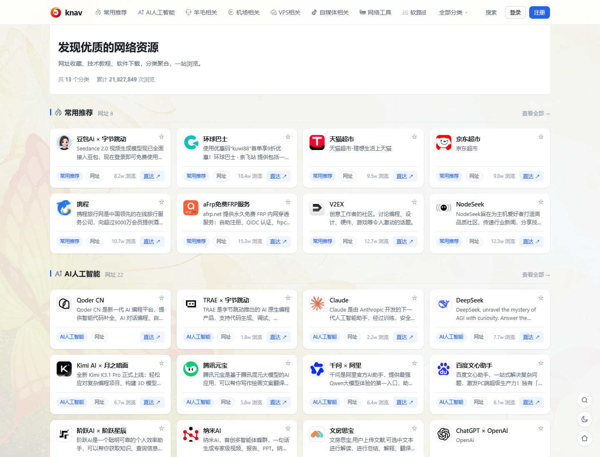
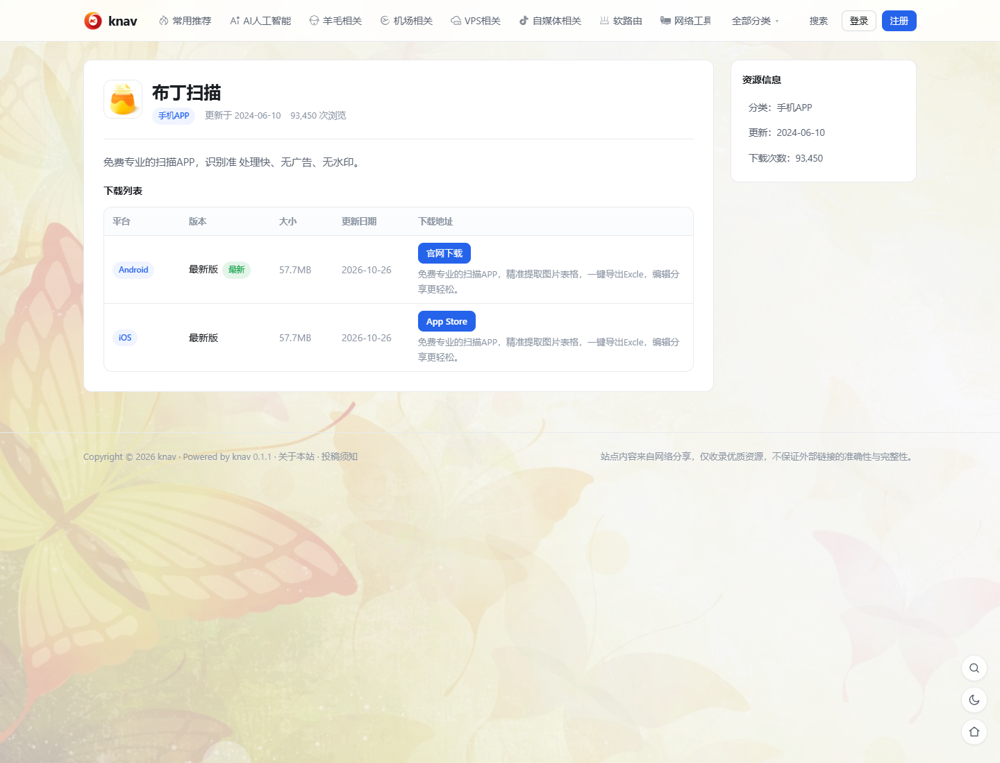
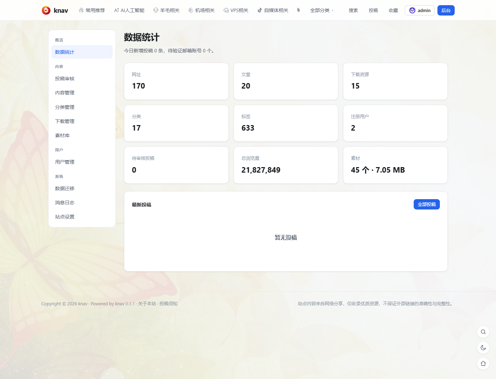

# knav

基于 **Next.js 15 + MySQL 8** 的导航站 / 资源分享站点系统。网址收藏、技术文章与软件下载共用同一套分类轴和卡片样式，站内自带账号体系、投稿审核、下载管理、素材库与完整后台。

演示站：<https://kuwi.net> ｜ 源码与文档：<https://github.com/KuwiNet/knav>





## 一行命令装好（应用与数据库都跑在 Docker 里）

```bash
curl -fsSL https://raw.githubusercontent.com/KuwiNet/knav/main/docker/install.sh | sudo bash
```

脚本会检查 Docker、生成随机口令、探测站点地址、等健康检查通过后再回取一次首页 CSS 才算装成，
结束时打印本机 / 内网 / 公网访问地址与站长初始密码（只打印一次）。参数用环境变量传：

```bash
curl -fsSL .../install.sh | sudo KNAV_DB=mariadb KNAV_PORT=8080 bash
```

已经 clone 仓库就用 compose，四种编排按需选：

```bash
docker compose -f compose.yaml -f compose.mysql.yaml up -d      # 应用 + MySQL 8.4
docker compose -f compose.yaml -f compose.mariadb.yaml up -d    # 应用 + MariaDB 11
docker compose -f compose.yaml up -d --build                    # 只起应用，数据库连外部的
docker compose -f compose.yaml -f compose.host.yaml up -d       # host 网络，对接宿主机已有的库
```

## 常用环境变量

| 变量 | 默认 | 说明 |
|---|---|---|
| `DB_HOST` / `DB_PORT` | `db` / `3306` | 数据库地址；用外部库时改成它的地址（容器里填 `127.0.0.1` 连不到宿主库，用 `host.docker.internal`） |
| `DB_NAME` / `DB_USER` | `knav` / `knav` | 库名与应用账号。自带的 MySQL / MariaDB 只在数据卷为空的第一次初始化时按它们建库建号 |
| `DB_PASS` | 必填 | 应用账号密码；带 `compose.mysql.yaml` / `compose.mariadb.yaml` 时留空会直接报错 |
| `MYSQL_ROOT_PASSWORD` | 用自带库时必填 | 数据库容器自己的 root 口令，也用于它的健康检查 |
| `SITE_URL` | `http://localhost:3000` | 外发绝对链接的基准（邮件里的验证/找回密码链接、OG、sitemap、OAuth 回调）；后台「站点设置 → 基础信息」优先级更高 |
| `ADMIN_USERNAME` / `ADMIN_PASSWORD` / `ADMIN_EMAIL` | `admin` / 空 / 空 | 首次建库时自动创建站长；已有站长不会改名、提权或重置密码 |
| `SMTP_HOST` 等 | 空 | 留空不发信，邮件只写进 `knav_mail_log` |
| `PORT` | `3000` | 对外端口（compose 里是 `${PORT:-3000}:3000`） |
| `KNAV_MIGRATE` | `1` | 启动时自动同步表结构；想自己控制迁移窗口就传 `0` |
| `TZ` | `Asia/Shanghai` | 壁纸「每天一张」按服务器本地日期切换 |

连**外部**数据库时请先把库建好并把建表权限给这个账号：knav 只执行 `db/schema.sql` 建表与幂等补列，
不会代你 `CREATE DATABASE`。

## 标签与架构

- `latest`：默认分支或任一 `v*` tag 发布时都会更新
- `<版本>` / `<主>.<次>` / `v<版本>`：随 GitHub Release 一起产出，例如 `0.1.4`、`0.1`、`v0.1.4`
- `main`：分支名标签，手动触发发布时产出

镜像同时构建 `linux/amd64` 与 `linux/arm64`，按架构自动取。运行层只有 Next.js standalone 产物，
非 root 用户运行，`HEALTHCHECK` 直接读 `/api/health`（连不上数据库返回 503，容器随即 unhealthy）。

## 特性

- **统一展示**：同一分类下的网址与文章混排，卡片外观一致，只有操作按钮不同
- **网址直达**：可接 YOURLS 短网址，点「直达」自动生成并复用短链；未配置时直连原网址
- **软件下载**：按「软件 → 平台版本 → 镜像链接」三层维护，支持多平台、多架构、多入口
- **账号体系**：邮箱注册验证、找回密码、站内通知、收藏，以及 Telegram / GitHub / Gitee / Google 第三方登录
- **内容编辑**：Markdown 与 HTML 富文本、代码块复制按钮、深浅模式跟随、远程图片自动本地化
- **数据迁移**：可从 knav、WordPress / OneNav、Typecho、Z-BlogPHP、Emlog、Halo 1.x 等站点的数据库一次性导入存量内容
- **完整后台**：分类与内容管理、投稿审核、用户与权限、素材库、通知与邮件日志、站点设置、备份导出

## 注意

镜像与仓库都**不包含数据库数据和上传文件**：`public/uploads/` 为空，装完是一个空站，
只有 `.env` 里指定的站长账号。备份与迁移见
[`docs/docker.md`](https://github.com/KuwiNet/knav/blob/main/docs/docker.md) 与仓库 README。
